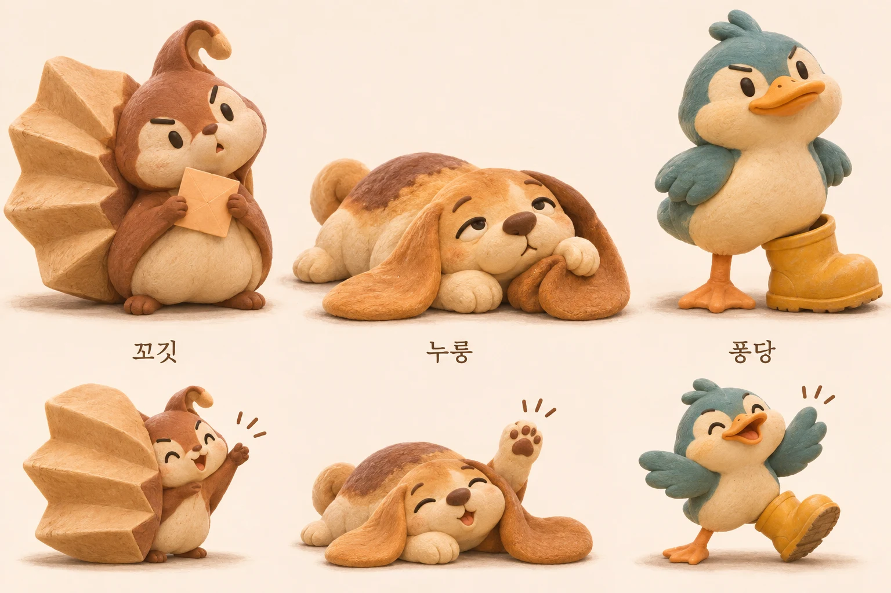
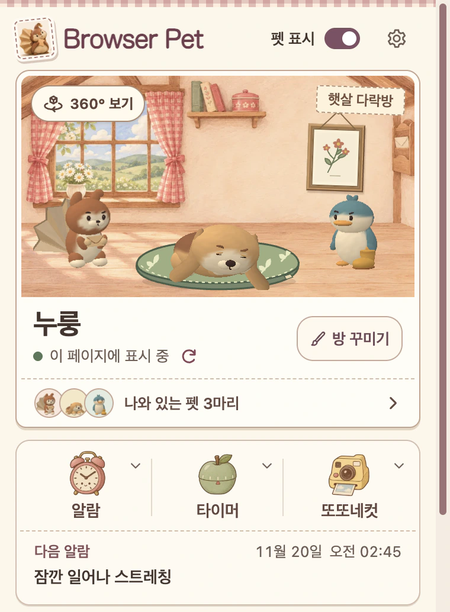
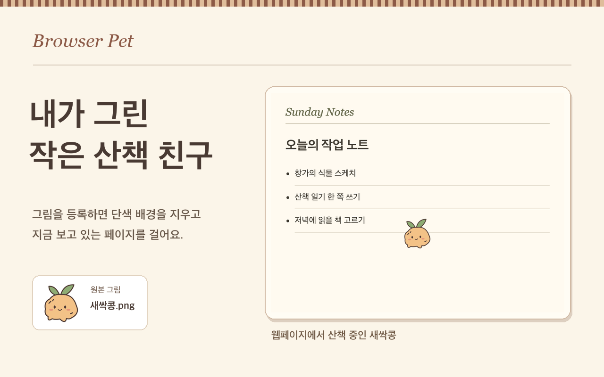
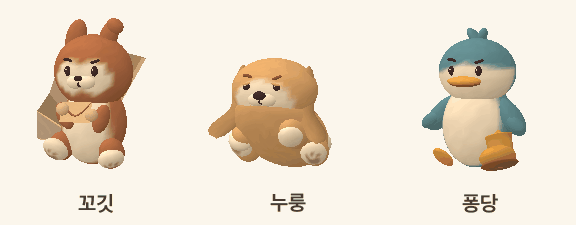

<h1 align="center">Browser Pet</h1>

  <strong>탭은 바뀌어도, 곁에 있는 친구는 그대로.</strong> 
  데스크톱 Chrome에서 함께 산책하는 꼬깃, 누룽, 퐁당을 만나 보세요. 
  일반 웹페이지에서 확장 아이콘을 열고 <strong>누룽 만나기</strong>를 눌러 보세요. 누룽이 먼저 손을 흔들어요.

  
   
  다락방의 세 친구 — 꼬깃, 누룽, 퐁당의 원화

## 셋 다 귀엽지만, 귀여운 이유는 달라요

| 꼬깃 / Kkogit | 누룽 / Nurung | 퐁당 / Pongdang |
| :---: | :---: | :---: |
| 접힌 쪽지를 꼭 안은 날다람쥐 | 긴 귀를 베개 삼는 졸음 강아지 | 장화 한 짝으로 뒤뚱거리는 아기 오리 |
| 종이부채 꼬리 뒤로 쏙. 인사는 조심스럽게 앞발 하나로. | 눕는 건 좋아해도 인사는 해요. 하이파이브는 편하게 뒷발로. | 인사할 때는 양 날개를 활짝. 걷는 모습부터 조금 남달라요. |

한 친구만 곁에 두어도, 셋이 함께 산책해도 좋아요. 친구마다 크기와 걸음새를 고르고 이름을 새로 지어 주세요. 별명도, 기분도, 함께 쌓은 경험치도 각자의 것으로 간직해요.

## 가운데 방석은 오늘 돌볼 친구 자리예요

분홍 체크 커튼이 달린 다락방에는 친구가 세 마리까지 모여요. **나와 있는 펫**에서 퐁당을 고르면 가운데 방석도, 아래에 펼쳐지는 돌봄 기록도 퐁당의 것이 돼요. 포만감이 낮으면 먹이를 주고, 머리도 한 번 쓰다듬어 주세요.

  
   
  다락방 아래 자명종은 알람, 초록 사과는 타이머, 노란 카메라는 또또네컷이에요.

장밋빛 스크롤바를 따라 내려가면 추억 앨범이 있어요. **방 꾸미기**에서 방석을 고르고, 첫 하이파이브로 얻은 카드를 벽에 걸어 보세요. 스카프를 매거나 산타 코트를 입은 날에는 **또또네컷**으로 그 차림을 찍어 이름과 날짜가 담긴 PNG로 간직할 수 있어요.

## 내가 고른 사진도 친구가 돼요

종이에 그린 낙서도, 우리 집 강아지 사진도 웹페이지를 산책할 수 있어요. 아래 새싹콩도 그림 한 장으로 만든 친구예요.

  

1. **그림을 골라요.** 확장 아이콘을 누르고 **톱니바퀴 → 내 친구 → 내 캐릭터**로 가세요. **캐릭터 추가**를 눌러 파일을 고르거나, 그 카드에 파일을 끌어다 놓으세요.
2. **이름을 짓고 걸음새를 골라요.** 미리보기에서 다섯 가지 움직임을 눌러 보세요. 옆모습 그림이라면 **그림이 보는 방향**을 맞춰 주면 친구가 걷는 쪽을 바라봐요.
3. **배경과 윤곽을 살펴봐요.** 기본으로 켜진 **단색 배경 자동 제거**가 그림 가장자리와 이어진 배경을 지워 줘요. 배경이 복잡한 사진은 투명 PNG로 준비하면 깔끔해요. 원래 배경을 살리려면 옵션을 끄고, 윤곽을 도톰하게 만들고 싶다면 **입체 스티커**를 켜 보세요.
4. **내 펫으로 등록**을 누르고 일반 웹페이지로 돌아가세요. 방금 고른 친구가 산책을 시작해요. 나중에 **내 캐릭터**에서 얼굴 카드를 누르면 꺼내거나 숨길 수 있고, 연필 버튼을 누르면 이름과 모습을 바꿀 수 있어요.

PNG, JPG, WebP, GIF를 파일당 **최대 5MB**, 이미지 친구는 **최대 다섯 마리**까지 등록할 수 있어요. 움직이는 GIF는 최대 120프레임까지 재생돼요. 그림은 내 기기에서 처리하고, 이 Chrome 프로필에는 표시용 사본을 저장해요.

정지 사진으로 만든 친구의 귀에 살구 리본을 달고 목에는 별밤 반다나를 둘러 보세요. **옷장 → 옷 입힐 친구**에서 사진을 고르고, 머리와 목에 하나씩 장식을 골라 원하는 위치로 끌어 놓으세요. **산책 미리보기**에서 마음에 들면 **차림 적용**을 누르세요.

## 그냥 바라보기만 하기엔, 너무 귀여워서

  
   
  앗, 들켰다. 프로젝트의 실제 입체 모형으로 만든 모션 미리보기

잡아 올리면 발버둥, 쓰다듬으면 하트, 손을 내밀면 짝.

공을 던지고 태엽 쥐를 풀어 주며 잠깐 놀아 주세요. 화면 구석에 데려다 놓으면 그 자리에서 기다리고, 산책을 다시 시작하면 놓인 자리에서 대각선으로 총총 걸어가요. 뒷모습이 궁금할 땐 360°로 돌려 볼 수도 있어요.

탭을 옮겨도 같은 친구가 이어서 함께해요. 이름이나 자리부터 다시 정할 필요 없이요.

## 집중할 때도 곁에 있어요

**남은 시간은 친구 머리 위에.** 다락방의 **타이머**에서 집중할 시간이나 문제 풀이 시간을 정해 보세요. 팝업을 닫고 문제로 돌아가도 펫 곁에 ‘집중 24:59’처럼 모드와 남은 시간이 보여요.

**매주 수요일 두 시엔 팀 회의, 매일 밤 아홉 시엔 약 먹기.** 웹페이지에서 펫을 누르고 **알람 관리**를 열면 그 자리에서 일정을 등록할 수 있어요. 한 번, 매일, 평일, 매주, 매월 중에서 고르세요. 시간이 되면 친구가 말풍선을 띄우고, 직접 **확인**할 때까지 기다려요. 여러 알람이 겹치면 하나를 확인한 뒤 다음 알람을 보여 줘요.

다음 일정이 궁금할 땐 확장 아이콘만 눌러 보세요. **다음 알람**에 날짜와 시각이 보이고, 그 아래로 긴 제목도 끝까지 읽을 수 있어요. 창이 좁아지면 세 그림 버튼은 세로 목록으로 바뀌어요.

## 내 브라우저에 사는 친구니까

- **가입 없이 함께해요.** 친구의 이름과 돌봄 기록, 직접 등록한 그림과 알람은 이 기기의 Chrome 프로필에 저장돼요.
- **새 컴퓨터에도 데려가요.** 환경설정의 **저장 데이터**에서 백업 파일 하나를 내보내고 새 컴퓨터에서 가져오세요. 직접 만든 친구와 추억 앨범, 등록한 알람까지 이어져요.
- **내가 보는 창에서 만나요.** 여러 일반 창을 띄워도 지금 사용하는 탭 한 곳에 나타나요.
- **조용히 있고 싶은 날도 있어요.** 표시 스위치로 숨기거나, 동작 줄이기로 움직임을 줄일 수 있어요.
- **익숙한 언어로 만나요.** Chrome의 표시 언어에 맞춰 한국어, 일본어, 영어, 스페인어로 메뉴와 말풍선을 보여 줘요. 다음 알람의 날짜와 시각도 해당 언어로 읽을 수 있어요.

함께할 수 있는 곳과 알림에 대해

데스크톱 Chrome의 일반 웹페이지에서 만날 수 있어요. 새 탭, Chrome 설정, 웹 스토어, 시크릿 창은 지원하지 않아요.

알람은 Chrome이 실행 중일 때 동작해요. Chrome을 종료했거나 기기가 잠들어 15분 넘게 지난 알람은 다시 열었을 때 최근 기록에서 확인할 수 있어요.

[개인정보 안내](docs/release/privacy.html)

---

  <strong>오늘은 누구와 함께할까요?</strong> 
  꼬깃, 누룽, 퐁당이 브라우저에서 만날 날을 기다리고 있어요. 
  현재 출시 준비 중입니다.

  <a href="docs/USER_GUIDE.md">사용 안내</a> /
  <a href="docs/DEVELOPMENT.md">개발 문서</a> /
  <a href="docs/PROGRESS.md">만들어 가는 과정</a>

